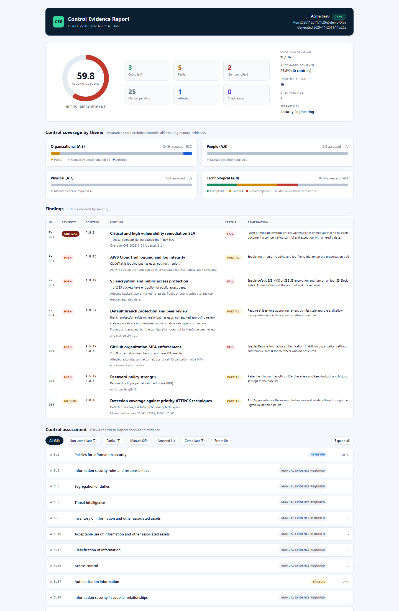
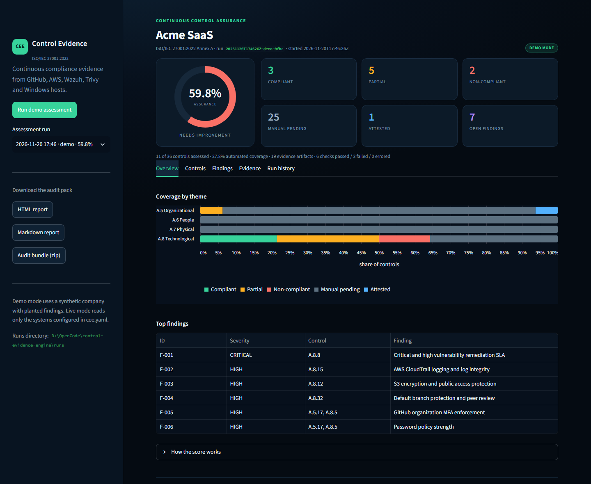

# Control Evidence Engine

> **Compliance-as-code for ISO/IEC 27001:2022.** Collect evidence from GitHub, AWS, Wazuh, Trivy and Windows hosts, map it to Annex A controls, hash every artifact, and generate an auditor-ready report with gaps and remediation actions.

[](https://www.python.org/)
[](https://www.iso.org/standard/27001)
[](LICENSE)
[](tests/)
[](https://github.com/Rudraksh-Dixit/control-evidence-engine/actions/workflows/compliance.yml)



**What this is:** a working compliance evidence pipeline, not a policy template. It treats GRC as telemetry: collect facts from the systems that actually run the business, map them to controls, preserve tamper-evident evidence, and show exactly where the gaps are.

**Demo in one command:** `python -m cee assess --demo` — no cloud accounts, tokens or credentials required. It builds a synthetic 9-person SaaS company with realistic planted findings, runs 13 checks, scores 36 ISO 27001 controls, and produces an HTML report plus a Streamlit dashboard.

---

## Why this exists

Most GRC portfolio projects are Excel risk registers and copied policy PDFs. They show that someone can read a framework, not that they can build the evidence chain an auditor actually needs.

This project was built from the other direction: a SOC/detection background, where evidence already exists in SIEM alerts, cloud audit logs, vulnerability scans and endpoint policy. The gap is translating that telemetry into control language — and doing it without pretending that a passing check equals certification.

CEE demonstrates the parts of GRC that are hard to fake:

- **Control mapping** — 36 Annex A controls, 10 wired to automated checks, 26 ready for manual attestation.
- **Evidence integrity** — every artifact is canonicalized and hashed with SHA-256; `verify` detects after-the-fact edits.
- **Honest scoring** — manual controls are excluded from the assurance score until evidence is attached. Nothing auto-passes.
- **Audit output** — findings sorted by severity, per-control drill-down, evidence manifest, sign-off block, portable ZIP bundle.
- **Hybrid assurance** — automated checks and attested documents live in the same control view.

---

## How it works

```text
  GitHub        AWS          Wazuh        Sigma        Trivy        Windows / filesystem
     |            |            |            |            |                 |
     +------------+------------+------------+------------+-----------------+
                                       |
                              check plugins (13)
                                       |
                          evidence artifacts (SHA-256)
                                       |
                     control mapping (YAML, 36 controls)
                                       |
                     assessment engine (score + findings)
                                       |
               +-----------------------+-----------------------+
               |                       |                       |
        HTML report              Markdown report          Streamlit dashboard
               |                       |                       |
               +----------------- audit-bundle.zip ------------+
```

The catalog is data, not code. `cee/frameworks/iso27001_2022.yaml` maps each control to any number of checks. A check only reports facts (pass / partial / fail / error); the engine decides what that means for a control. Adding SOC 2, CIS v8 or a custom framework is a YAML exercise, not a refactor.

---

## Quickstart

```powershell
cd D:\OpenCode\control-evidence-engine
py -m pip install -r requirements.txt
py -m cee assess --demo
py -m cee dashboard
```

On macOS/Linux use `python` instead of `py`. The assessment also works as an editable install:

```bash
pip install -e ".[dashboard,dev]"
cee assess --demo
```

Open the generated report:

```powershell
py -m cee report --run latest --open
```

### Demo results (fresh clone, same data)

| Metric | Value |
|---|---|
| Assurance score | **59.8%** — needs improvement |
| Controls assessed | 11 / 36 |
| Automated coverage | 27.8% (10 controls) |
| Checks | 6 pass / 4 partial / 3 fail / 0 error |
| Evidence artifacts | 19 |
| Open findings | 7 (1 critical, 5 high, 1 medium) |

The synthetic company has seven intentional gaps:

| Finding | Control | Why it matters |
|---|---|---|
| 2 of 9 GitHub members lack MFA, including an org admin | A.5.17, A.8.5 | Account takeover path into source code |
| Branch protection does not require peer review | A.8.32 | Unreviewed production changes |
| CloudTrail is single-region | A.8.15 | Blind spot outside the home region |
| Marketing S3 bucket is unencrypted and allows public access | A.8.12 | Data exposure |
| Critical CVE-2026-1101 is 21 days old against a 7-day SLA | A.8.8 | Known exploitable vulnerability left open |
| Minimum password length is 8 | A.5.17 | Weak credential baseline |
| Sigma covers 8 of 12 priority ATT&CK techniques (67%) | A.8.16 | Detection blind spots |

Passing evidence is there too: root MFA, GuardDuty coverage, secret scanning with push protection, fresh backups with retention, audit policy for logon and lockout events, and a live Wazuh alert pipeline.

---

## Screenshots

| Auditor report | Dashboard |
|---|---|
|  |  |

---

## Commands

| Command | What it does |
|---|---|
| `python -m cee assess --demo` | Run the synthetic assessment and generate reports |
| `python -m cee assess --live --config cee.yaml` | Collect evidence from configured live systems |
| `python -m cee report --run latest --open` | Re-render the HTML/Markdown report |
| `python -m cee controls --run latest` | List the catalog with the latest control status |
| `python -m cee attest --control A.5.1 --file policy.pdf --note "Approved 2026-10-15"` | Attach hashed manual evidence |
| `python -m cee attest --list` | List manual attestations and integrity state |
| `python -m cee verify --run latest` | Recompute every evidence hash |
| `python -m cee runs` | List assessment runs |
| `python -m cee dashboard` | Launch the Streamlit dashboard on port 8502 |

Every run lives in `runs/<run-id>/`:

```text
run.json                 machine-readable assessment
report.html              auditor-facing report
report.md                version-control-friendly report
evidence/                per-check artifacts with hashes
evidence/manual/         copied attestation documents
demo/                    synthetic fixtures (demo mode only)
audit-bundle.zip         portable evidence pack
```

---

## Live mode

Copy the example configuration and fill in only what you can access:

```powershell
Copy-Item cee.example.yaml cee.yaml
$env:GITHUB_TOKEN = "github_pat_..."
py -m cee assess --live
```

| Source | Required configuration | Minimum access |
|---|---|---|
| GitHub | `github.org`, `github.repo`, `GITHUB_TOKEN` | Repository read; org owner + `read:org` for org-wide MFA |
| AWS | `aws.profile`, `aws.regions`, `pip install boto3` | Read-only: CloudTrail, S3, IAM, GuardDuty, STS |
| Wazuh | `wazuh.alerts_path` | Read access to `alerts/alerts.json` |
| Sigma | `sigma.rules_dir` | Read access to the rules repository |
| Trivy | `trivy.report_path` | A JSON report from `trivy image --format json` |
| Backups | `backup.path` | Read metadata for backup artifacts |
| Windows | none | Local `net accounts`; `auditpol` may need administrator |

Checks that cannot run are marked **error** with a remediation hint instead of silently passing. Unconfigured live checks do not fabricate evidence.

### Manual evidence

26 controls in the catalog are intentionally not automatable (policy approval, supplier due diligence, training records, physical access, incident exercises). Attach them as hashed documents:

```powershell
py -m cee attest --control A.5.1 `
  --file .\docs\information-security-policy.pdf `
  --note "Approved by the Audit and Risk Committee; next review 2027-10-15" `
  --by "CISO"
```

The file is copied into `manual_evidence/`, hashed, and registered. The next assessment marks the control **attested** only if the hash still matches. Report output distinguishes automated, attested and still-missing controls.

---

## Control coverage

36 controls across the four Annex A themes. 10 are backed by automated checks:

| Control | Automated evidence | Checks |
|---|---|---|
| A.5.17 Authentication information | Org MFA + Windows password policy | `github_mfa`, `windows_password_policy` |
| A.8.2 Privileged access rights | AWS root MFA and access keys | `aws_root_mfa` |
| A.8.5 Secure authentication | Org MFA + password baseline | `github_mfa`, `windows_password_policy` |
| A.8.8 Technical vulnerabilities | Trivy critical/high SLA | `trivy_vulnerability_sla` |
| A.8.12 Data leakage prevention | S3 encryption and public access block | `aws_s3_public_block` |
| A.8.13 Information backup | Freshness and retention | `backup_freshness` |
| A.8.15 Logging | CloudTrail + Windows audit policy | `aws_cloudtrail`, `windows_audit_policy` |
| A.8.16 Monitoring activities | SIEM health, ATT&CK coverage, GuardDuty | `wazuh_alert_pipeline`, `sigma_detection_coverage`, `aws_guardduty` |
| A.8.28 Secure coding | Secret scanning and push protection | `github_secret_scanning` |
| A.8.32 Change management | Branch protection and peer review | `github_branch_protection` |

The full 36-control mapping, including manual evidence expectations, is in [docs/control-mapping.md](docs/control-mapping.md).

---

## Scoring and evidence integrity

Each check returns `pass` (1.0), `partial` (0.5), `fail` (0.0), `error` (0.0) or `not_applicable` (excluded).

- **Control score** = mean of its applicable check scores.
- **Control status** = compliant (all pass), partial (mixed), non-compliant (none pass), attested (verified manual evidence), manual (no evidence yet), error.
- **Assurance score** = mean across compliant, partial, non-compliant and attested controls. Manual-pending controls are excluded, so the score cannot be inflated by writing policies and never attaching them.
- **Bands** = strong (85+), moderate (65–84.9), needs improvement (40–64.9), critical (<40).

Every evidence artifact is stored as JSON with a SHA-256 of its canonical content. `run.json` records the hash; `python -m cee verify` recomputes it and fails if any byte changed. Manual documents are hashed as raw files. The audit bundle is a self-contained ZIP of the run.

Detailed rationale, threat model and extension guide: [docs/methodology.md](docs/methodology.md).

---

## Repository layout

```text
cee/
  checks/                13 check plugins (GitHub, AWS, Wazuh, Sigma, Trivy, Windows, backup)
  frameworks/
    iso27001_2022.yaml   36-control catalog and mappings
  templates/             auditor report (HTML + Markdown)
  engine.py              orchestration, scoring, findings
  evidence.py            hashing, bundles, verification
  report.py              report context and rendering
  attest.py              manual evidence registry
  demo.py                synthetic company with planted findings
  cli.py                 assess / report / controls / attest / verify / runs / dashboard
dashboard/app.py         Streamlit dashboard
scripts/                 control-mapping generator
tests/                   20 pytest tests covering checks, scoring, evidence, reports
docs/                    methodology, control mapping, screenshots
.github/workflows/       CI: lint, test, assess, verify, upload evidence
```

---

## Design decisions

- **Checks collect facts; the catalog owns meaning.** This keeps control logic reviewable by non-engineers and lets one check support multiple frameworks.
- **No auto-passing manual controls.** A GRC tool that marks policy controls green because a file exists is a compliance theatre generator. Attestation is explicit, hashed and separate.
- **Demo mode is first-class.** A reviewer can clone, run one command and see a complete assessment without cloud credentials. Demo data is labelled everywhere, and every finding is explainable in the report.
- **Evidence over screenshots.** Each finding links to an artifact, source and hash, so an auditor can trace the conclusion back to raw configuration or logs.
- **Fail loudly, not green.** Misconfigured tokens, missing files and unsupported hosts produce `error` findings with remediation, never a silent pass.
- **Small, boring dependencies.** PyYAML, Jinja2, requests, rich; Streamlit/Altair only for the dashboard; boto3 optional.

---

## Limitations and roadmap

This is technical evidence, not a certification or legal opinion. The catalog covers 36 of 93 Annex A controls; ISO/IEC 27001 text is licensed and only control titles are referenced. Live checks depend on token scope and system access. Evidence may contain sensitive metadata, so review artifacts before sharing a bundle externally.

Planned work:

- SOC 2 Trust Services Criteria and CIS Controls v8 catalogs
- Entra ID / Okta, GCP and Azure checks
- Exception and risk-acceptance workflow with expiry dates
- Scheduled runs with score trends and drift alerts
- Evidence redaction rules for log samples
- PDF export with an audit sign-off page

---

## Stack

Python 3.11+ · PyYAML · Jinja2 · Rich · Streamlit · Altair · pytest · Ruff · GitHub Actions

Built by [Rudraksh Dixit](https://github.com/Rudraksh-Dixit) — SOC analyst and detection engineer, B.Tech CSE (Cybersecurity), Gautam Buddha University.

MIT License. Not affiliated with or endorsed by ISO.
